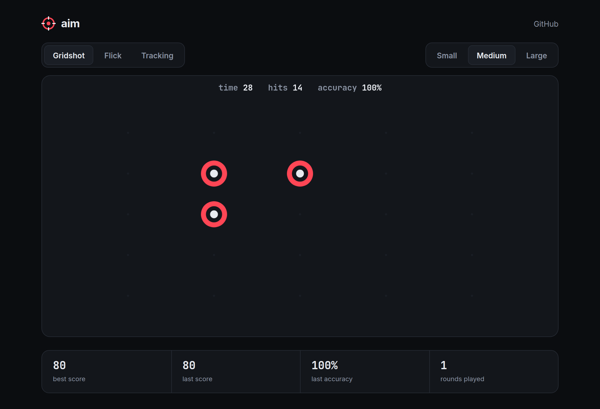

# aim

Aim trainer that runs in the browser. Rounds are 30 seconds and your scores are saved so you can see whether you're improving.

**https://salw2e.github.io/aim**

To run it locally, open `index.html` in a browser.

| Mode | What you do |
|---|---|
| Gridshot | three targets at a time, click them as fast as you can |
| Flick | one small target at a time, far from the last one |
| Tracking | keep your cursor on a moving target |

Gridshot and Flick score hits times accuracy. Tracking scores the time spent on the target. Targets come in three sizes, and each size keeps its own scores. The Share button makes a link that challenges a friend to beat your score.

Missing: hit sounds, online leaderboard
